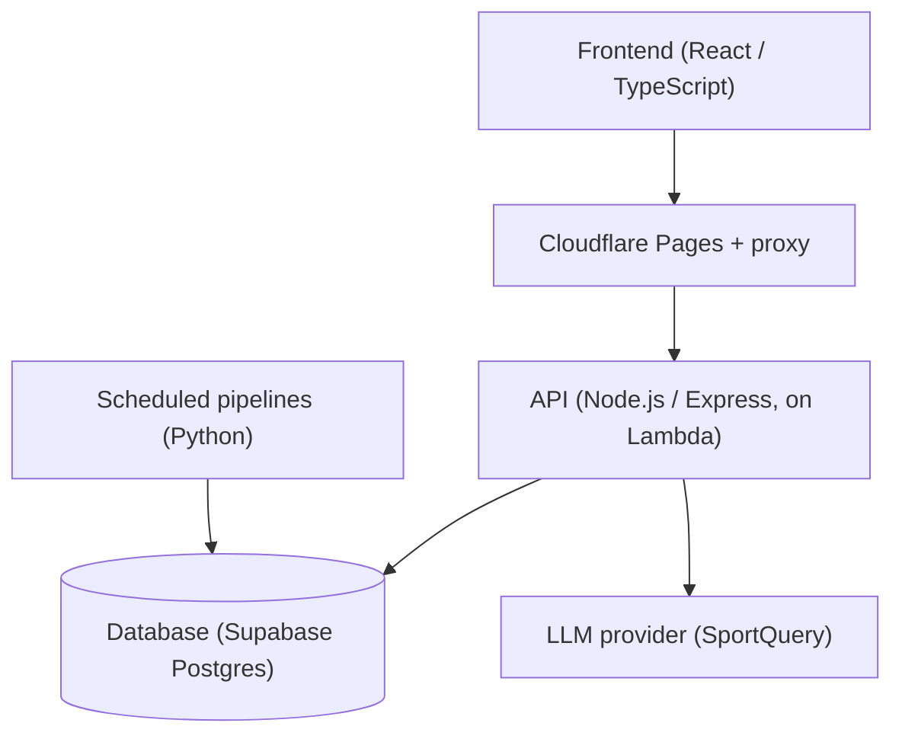
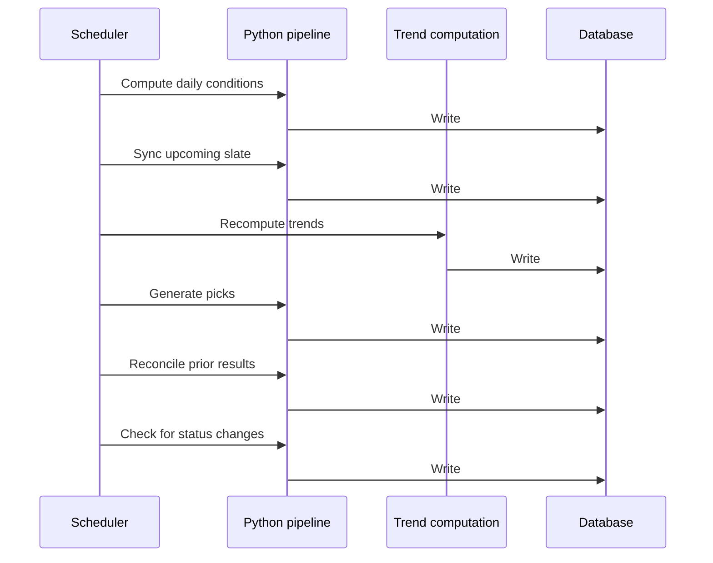
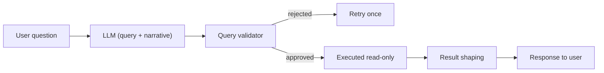
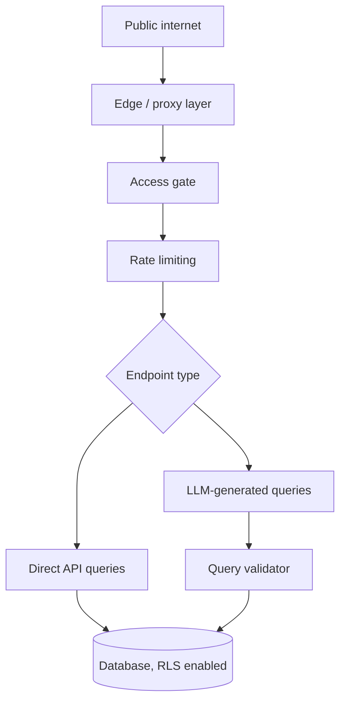

# StatTrak Sports

**[stattraksports.pages.dev](https://stattraksports.pages.dev/)**

A multi-sport analytics platform covering NBA, MLB, NFL, and NHL. The product surfaces model-driven picks, streaks, and trends, and is designed to be transparent about its own scoring rather than prescriptive about what to act on.

---

## Table of contents

- [System architecture](#system-architecture)
- [Core components](#core-components)
- [Data pipeline](#data-pipeline)
- [SportQuery](#sportquery)
- [Database](#database)
- [Security](#security)
- [CI/CD & deployment](#cicd--deployment)
- [Local development](#local-development)
- [Testing](#testing)

---

## System architecture

The platform runs as a static single-page application in front of a serverless API, with a separate scheduled pipeline that populates the same database the API reads from.



The frontend never calls the API directly; it goes through a proxy layer, which is the primary access control described in [Security](#security). Data ingestion, scoring, and grading run on a separate schedule, independent of user traffic.

---

## Core components

| Layer | Stack | Notes |
|---|---|---|
| **Frontend** | React, TypeScript, Tailwind/SCSS, Vite | Dark theme, monospace type. Each sport is organized around three surfaces: **Picks**, **Streaks**, and **Trending**. |
| **API** | Node.js, Express | Controllers are league-agnostic; a per-sport configuration object supplies table names, stat mappings, and box-score layout. |
| **Data pipelines** | Python | Per-sport ingestion (NBA, MLB, NFL, NHL) into a shared schema, keyed on internal canonical IDs. |
| **Scoring** | Python, deterministic rules | A shared four-component model (baseline, matchup modifier, situational modifier, variance estimate), extended per sport through sport-specific condition extractors. |
| **SportQuery** | Node.js + LLM | Conversational natural-language interface over the same schema. |
| **Database** | Supabase (Postgres) | Central fact table for scored picks, joined to per-sport stats and trends tables. |

---

## Data pipeline

Six scheduled jobs carry data from ingestion through to grading each day.



Trends are recomputed before picks are generated, and grading for a given day is deferred to the following day rather than attempted while games may still be in progress.

---

## SportQuery

SportQuery converts a plain-English question into a database query without granting the underlying model direct database access.



Every generated query is parsed and checked before it runs: only a single read-only statement is permitted, only an approved set of tables is reachable, and results are capped in size. A rejected or failed query is retried once with the reason appended, and results are never cached in a way that could cross sessions, since no user login exists to separate them.

---

## Database

Supabase Postgres. All application tables live in a single schema, with a central fact table for scored picks joined to per-sport stats, trends, and standings tables.

Access is split by role: the main API uses a privileged role for ordinary reads and writes; SportQuery's generated queries run under a separate, restricted, read-only role scoped by row-level security policies.

---

## Security

The platform has no end-user authentication, so security is layered rather than resting on a single control.



- **Proxy layer.** The frontend reaches the API only through a proxy, which is the sole caller permitted to reach it directly.
- **Access gate.** Requests are checked against a shared credential before reaching application logic; failure is closed rather than open in production.
- **Standard hardening.** Secure headers and a restrictive cross-origin policy, since the proxy is the intended path rather than a backstop.
- **Rate limiting.** Applied per endpoint, with SportQuery limited more tightly given its per-call cost.
- **Cache policy.** Responses are cached only where appropriate; anything tied to a user session is excluded to prevent cross-session leakage.
- **Row-level security.** Enabled on every table, with distinct, narrowly scoped roles for ordinary API access versus SportQuery's generated queries.
- **Query validation.** LLM-generated queries are parsed and restricted to a single read-only statement, an approved table set, and a result-size cap before execution.
- **Session scoping.** Conversational sessions are scoped to an anonymous per-client identifier, with ownership checked on every access.

---

## CI/CD & deployment

The API is bundled and deployed to a serverless function, fronted by the proxy layer described above. A unit test suite covers the components most consequential to correctness and security. Scheduled data jobs run independently of the request path, driven by a scheduler suited to the deployment target.

An automated workflow gating merges on the test suite was not confirmed in the material available. If one already exists, this section should be updated to describe it directly; if not, it is a natural next addition given the pieces already in place.

---

## Local development

```bash
cd server
cp .env.example .env
npm install
npm run dev
```

```bash
python -m venv venv
source venv/bin/activate
pip install -r requirements.txt
```

The access gate is disabled automatically in local development when its credential is unset, so no additional configuration is required to run the API locally.

---

## Testing

```bash
npm test
npm run test:watch
```

Coverage is concentrated on the components where a defect would be a correctness or security issue rather than a cosmetic one: the access gate, the cache policy, and the query validator.
